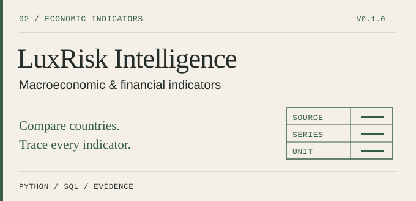

# LuxRisk Intelligence

**Read the movement. Keep the evidence.** An economic evidence desk for comparing European macroeconomic series, inspecting revisions and translating explicit assumptions into currency and interest-rate exposures.

Built by [Zubair Emritte](https://github.com/zubairemritte). **Version 0.1.0: local analytical workspace.**

[Start here](docs/quickstart.md) · [Read the code](docs/start-here.md) · [Methodology](docs/methodology.md) · [Source register](docs/sources.md) · [Power BI](docs/power-bi.md) · [Compatibility](docs/compatibility.md)

## A question an analyst can answer

“Has this indicator changed materially, are peer values comparable, and can I explain the exact source and calculation behind the result?”

Each panel links an observation to its unit, frequency, provider query, ingestion timestamp, raw-response SHA-256 fingerprint and stored vintage. A second collection preserves the earlier slice and exposes value and flag changes. Monthly and quarterly series remain separate; country comparisons use the latest common nonmissing period.

This connects applied economics, statistical reasoning, SQL data quality and a usable analytical product. A successful run is auditable from the original bytes to the displayed number.

## What is implemented

| Capability | Concrete behaviour |
| --- | --- |
| Official source adapters | Eurostat inflation, unemployment and real GDP growth; ECB monthly USD-per-EUR reference rate |
| Configurable geography | 16 configured European country codes; actual coverage depends on the selected series and returned data |
| Safe collection | Explicit date windows, request/response budgets, strict source-dimension checks and atomic multi-series publication |
| Vintage ledger | Append-only SQLite storage, exact source bytes, fingerprints, status flags and prior-success preservation |
| Investigation signal | Prior-window z-score; missing history, flat references and source breaks handled explicitly |
| Forecast baselines | Naive vs drift, identical one-step expanding origins, MAE/RMSE and inspectable predictions |
| Conditional scenarios | Fixed USD invoice and floating-rate debt arithmetic; every assumption is visible |
| Local evidence desk | English interface, source drill-down, vintage selector, peer comparison and observation table |
| BI handoff | Star-schema CSV pack, pinned source manifest and generated analytical brief; Power BI model/DAX instructions |
| Reproduction | Python 3.12, Poetry, exact development versions, lockfile and four-profile CI configuration |

**The project has no third-party runtime dependencies.** SQLite, HTTP, validation and statistical baselines use Python's standard library. Poetry locks the development tools and build backend. This keeps the first release installable without native data-science libraries; it does not promise every machine configuration will work.

## Start with small offline checks

Use Python **3.12** and Poetry **2.5.1**. All commands run from the repository root. [Installation details](docs/quickstart.md).

```bash
poetry env use 3.12
poetry sync
poetry run luxrisk doctor
poetry run pytest -q
```

Tests use tiny authored fixtures and temporary databases. They do **not** run a full demo, a live collection or a cloud deployment.

### Explore locally when ready

```bash
poetry run luxrisk demo
poetry run luxrisk serve --mode demo
```

Open **http://127.0.0.1:8010**. The demo contains deliberately authored values for four countries and shared FX context. It never claims to reproduce an official economic history.

### Collect an explicit official slice

```bash
poetry run luxrisk collect --country DE --indicators inflation,unemployment --start 2025-01 --end 2025-03
poetry run luxrisk collect --country DE --indicators gdp --start 2025-Q1 --end 2025-Q2
poetry run luxrisk collect --country DE --indicators eurusd --start 2025-01 --end 2025-03
poetry run luxrisk coverage --mode live
poetry run luxrisk serve --mode live
```

Country is a parameter, not a fixed target market. EURUSD is stored under **EA / shared currency context** and is not attributed to the selected country's economy. These small windows validate ingestion; longer histories are needed before anomaly/forecast panels become available.

```bash
poetry run luxrisk inspect --country DE --indicator inflation --mode live
poetry run luxrisk compare --countries DE,FR --indicator inflation --mode live
poetry run luxrisk export --mode live --output exports/first-official-pack
poetry run luxrisk scenario --eurusd 1.1 --imports-usd 100000 --fx-shock-pct -10 --debt-eur 500000 --rate-shock-bps 100
```

The peer command requires both countries to have collected values. Export refuses to overwrite an existing directory. To select a different database, place `--db workspace/another.sqlite` **before** the command.

## Read four files first

1. [`cli.py`](luxrisk/cli.py): what operation was requested?
2. [`pipeline.py`](luxrisk/pipeline.py): how does a source slice become a published vintage?
3. [`connectors.py`](luxrisk/connectors.py): how is the official series contract checked?
4. [`analysis.py`](luxrisk/analysis.py): how is a displayed result calculated?

[The reading map](docs/start-here.md) explains the four operational classes and the supporting data records. [The function index](docs/function-index.md) links every Python definition. Public code, comments, interface and documentation are in English.

## Analytical boundaries

- Provider availability is observed, not inferred from the country selector. A missing series stays unavailable.
- Eurostat's API serves revised current data. Locally collected vintages begin with your own ingestion; backtests do not pretend historical publication-time availability.
- Model selection uses its reported evaluation window. Scores are descriptive baseline evidence, not independent holdout performance.
- Investigation flags have no labelled precision/recall claim. A small historical review is a follow-up, not a result fabricated for this release.
- Scenario outputs are conditional arithmetic. The project does not produce an official credit rating or a personalised investment recommendation.
- CSVs and modelling instructions are delivered for Power BI; a native `.pbix` report has not been built or validated.
- dbt, a cloud warehouse and complex predictive models are not required by this local release. [Design decisions](docs/architecture.md) explain that boundary.

## Verification

See [release evidence](docs/release-0.1.0.md) for the checks actually executed and the separate status of the four configured CI profiles. No full collection or full demo is run as part of development verification.

The code is MIT-licensed. Source data retain their providers' terms and attribution requirements; see the [source register](docs/sources.md).
